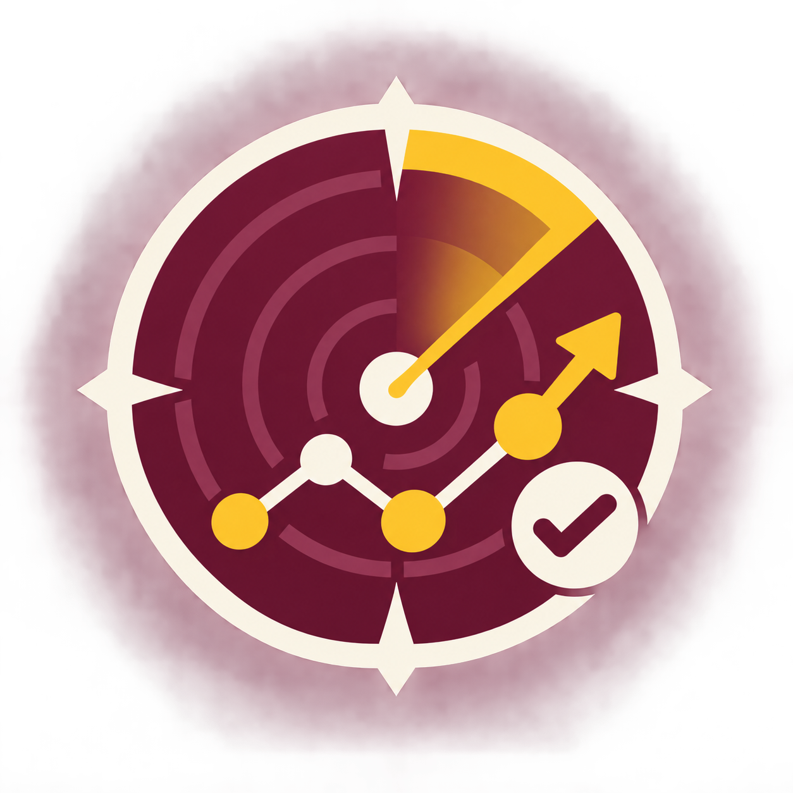

# TrendScout AI - Group 11

<p align="center">
  
</p>

**CSE 573: Semantic Web Mining | Fall 2026 | Group 11 | Project 5**

TrendScout AI is a CSE 573 Semantic Web Mining project that combines public startup signals with a temporal knowledge graph and evidence-aware conversational retrieval.

The system is designed to answer not only *what is trending?*, but also *why is it considered a trend, when was the evidence observed, and which independent sources support or dispute it?*

## Team

- Sueda Sen
- Mehmet Aksit
- Vidya Sagar Dudekula
- Faisal Barkat Khorasi

## Current status

The repository has a frozen 18-company cohort, a named-source registry, Sueda's news/company/public-voice collectors, origin clustering, a BM25 baseline, and an evaluation design. Ontology, the temporal graph, weekly activity features with an EWMA baseline, dense retrieval, query routing, and the conversational interface are in place. ATS/GitHub collection is open in PR #3, and the scored evaluation has not been run yet.

The submitted proposal is available at [`docs/proposal/TrendScout_AI_Project_Proposal_G11_P5.pdf`](docs/proposal/TrendScout_AI_Project_Proposal_G11_P5.pdf). The live work division is [`docs/project-plan.md`](docs/project-plan.md).

## Project scope

- Study a focused cohort of 15–20 AI startups in agent infrastructure and developer tools.
- Collect public news, company announcements, job postings, and GitHub activity.
- Normalize records through a shared JSON contract.
- Represent claims, timestamps, provenance, and evidence status in a temporal knowledge graph.
- Compare classical baselines with modern retrieval and extraction methods.
- Return cited answers or explicitly report insufficient evidence.

## Repository structure

- `collectors/` — independent news, jobs, and GitHub collection modules
- `schemas/` — shared JSON records and validation contracts
- `ontology/` — ontology, RDF/PROV-O, and SHACL files
- `graph/` — Neo4j loading and graph-query code
- `signals/` — weekly activity features and the EWMA trend baseline
- `retrieval/` — BM25, dense retrieval, and query routing
- `interface/` — conversational interface and citation display
- `evaluation/` — test sets, metrics, baselines, and ablations
- `data/` — local data layout; raw datasets are not committed by default
- `docs/` — proposal, architecture, project plan, source policy, and contribution notes

## Initial workflow

1. Finalize scope and source policy.
2. Approve the shared JSON schema.
3. Freeze the cohort and collect Sueda's documentary records.
4. Create one-startup pilot records through jobs, GitHub, graph, and retrieval.
5. Expand only after the end-to-end pilot works.

Sueda's local collection:

```bash
python -m pip install -r requirements.txt
python -m pytest
python -m collectors.run --live --out data/processed/sueda
```

## System flow

```text
Public signals (news, jobs, GitHub, company pages)
                         |
                         v
Normalized evidence records -> deduplication -> claim extraction
                         |
                         v
Temporal knowledge graph + evidence ledger + document index
                         |
                         v
Hybrid retrieval -> cited answer, qualification, or abstention
```

See [`docs/architecture.md`](docs/architecture.md) for the component boundaries and [`docs/project-plan.md`](docs/project-plan.md) for milestones and ownership.

## Data and access rules

- Use documented APIs, RSS feeds, and permitted public pages.
- Do not collect applicant data, private profiles, credentials, or restricted content.
- Store source URL, publisher, retrieval time, event/publication time, and content hash.
- Do not commit API keys, tokens, secrets, or large raw datasets.
- Record third-party licenses and clearly distinguish team-authored code.

## Important documents

- [Project proposal](docs/proposal/TrendScout_AI_Project_Proposal_G11_P5.pdf)
- [Architecture and module contracts](docs/architecture.md)
- [Project plan and responsibilities](docs/project-plan.md)
- [Evidence ledger rules](docs/evidence-ledger.md)
- [Source and access policy](docs/source-policy.md)
- [Weekly features, trends, and the interface](docs/faisal-trends-and-retrieval.md)
- [Contribution conventions](docs/contributing.md)
- [Repository governance and review policy](docs/governance.md)

## License

No reuse license has been selected yet. Until the team approves one, all rights remain with the project contributors. Third-party datasets, APIs, models, and libraries retain their own terms.
